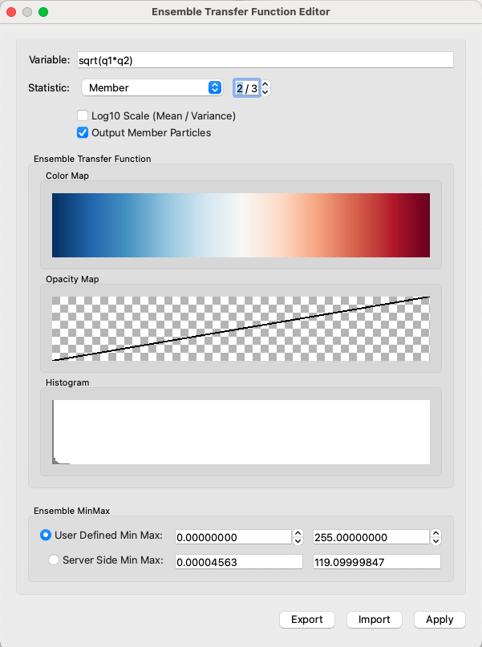

# アンサンブル伝達関数エディタ                                                                                                                                                                                 
アンサンブル伝達関数エディタでは、伝達関数エディタと同様に物理値の統計量に割り当てられる色および不透明度を定義する伝達関数が作成できる。

- **Variable**: 計算する統計量の関数式を指定する。
- **Statistic ボックス**: 可視化する統計量 または アンサンブルメンバ を指定する。
- **Log10 Scale (mean/varience) チェックボックス**: 統計量を常用対数表示するかしないかを切り替える。
- **Output Menber Particle チェックボックス**: 各アンサンブルデータの出力するかしないかを切り替える。
- **Exportボタン**:作成した伝達関数をファイルに保存する
- **Importボタン**:作成した伝達関数ファイルを読み込む
- **Applyボタン**:作成した伝達関数ファイルを適用する

※ **Variable**で指定できる変数、演算子については[Opacity Function Editor](##Opacity_Function_Editor), [関数エディタ](##関数エディタ)参照

## 可視化表示する統計量の選択方法
 関数式にて計算される統計量は平均(average)、分散(varience)、変動係数(coefficient of variation)の3種類である。表示したい統計量について、Statisticボックスから選択し、applyボタンを押すことで設定が反映される。

## 各アンサンブルメンバの指定方法
 各アンサンブルメンバを表示したい場合は Statisticボックスの"member"を選択し、隣のスピンボックスにてidを入力し、applyボタンを押すことで表示される。

## 常用対数表示の切り替え
 Variableでは、常用対数の数式に対応している。ただし、これを用いた場合常用対数を用いた値での統計量（アンサンブル間で幾何平均を対数化した値）を表示し、算術平均を対数化した値ではない。
 算術平均を対数化した値を表示したい場合、Log10 Scale (mean/varience) チェックボックスをONにし、applyボタンを押下する。

具体例：　f = log(q1) と f = q1　かつLog10 Scale　ボタンONの平均値について

f = log(q1)

f = q1　かつLog10 Scale　ボタンON

## Ensemble Transfer Functionカテゴリ
- **colorMap**:variableにて指定された式の統計量に色付けするカラーマップを表示している。ダブルクリックでColor Map Editorを開く
- **opacityMap**:variableにて指定された式に対するオパシティマップを表示している。ダブルクリックでColor Map Editorを開く
- **Histogram**: EnsembleMinMaxカテゴリにて指定した最小最大値の範囲のヒストグラムが表示される

※ Color Map Editor の 使い方は[Color Map Editor](##Color_Map_Editor)参照  

※ Opacity Map Editor の 使い方は[Opacity Map Editor](##Opcity_Map_Editor)参照

## Ensemble MinMax カテゴリ
- **User Defined MinMax**: Variableにて指定された式に対して、色関数/不透明度関数を割り当てる最小最大値を指定する 
- **Server Side MinMax**: Variableにて指定された式の統計量の最小最大値を表示する

                
